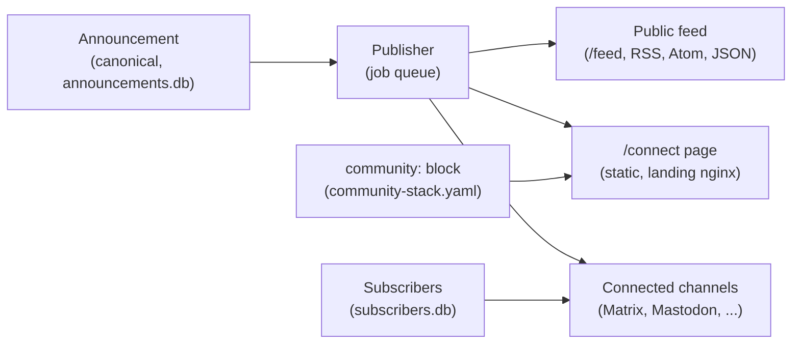

# Communication Resilience: Architecture

Status snapshot: 2026-11-02. CR0.1 code/configuration/deployment audit and
coverage baseline are complete; live acceptance remains open. CR1 is implemented in the current working tree,
including CR1.7 image uploads, which are not yet deployed. CR2.1–CR2.14 are
implemented, and D3 was approved by John Doe on 2026-11-02. Full plan:
[COMMUNICATION_RESILIENCE_ROADMAP.md](COMMUNICATION_RESILIENCE_ROADMAP.md).
Decisions: [ADR 0008](decisions/0008-communication-resilience.md).

## Goal
A community keeps the reach of proprietary networks and can still reach its
members when one of them goes away. Members set up independent channels
voluntarily, before anything goes wrong.

## Architecture

- **Canonical content.** Announcements are written to `announcements.db`
  before anything is sent. Every channel is an output of that store.
- **Identity.** The `community:` block holds the name, URL, logo, contact,
  emergency note and social accounts. It is optional, and defaults keep older
  configurations working.
- **Channels on `/connect`.** Only channels that are switched on and actually
  connected are listed. Anything else is hidden, and `connect show` says why.
- **Refresh.** The publisher rebuilds `/connect` after every publish, edit or
  withdrawal, whether or not a channel accepts the job.

## Data ownership

| Data | Where | Public? |
| --- | --- | --- |
| Profile and channel switches | `community-stack.yaml` | Yes, shown on `/connect` |
| Announcements and delivery history | `data/announcements/announcements.db` | Published items only |
| Subscribers (phone numbers, addresses) | `data/announcements/subscribers.db` | Never |
| Logo and cover | Config directory or `data/announcements/media/community`; uploads are re-encoded without metadata | Yes |
| Offline package | `backups/`, built on demand | Public data only |

## Security and privacy
- Subscriber data never appears in feeds, `/connect`, `community.json` or
  archives. A test enforces the last one.
- The page has no JavaScript and loads nothing from outside the stack.
  All profile text is HTML-escaped.
- Logos and covers are re-encoded to remove metadata such as GPS location.
  Console uploads are limited to 2 MB and stored in the backed-up data volume.
  SVG is not accepted, because the page shares an origin with `/admin`.
- The email privacy and consent wording was approved by a named reviewer on
  2026-11-02. The approval flag enables sign-up when an SMTP connection is
  configured; unsubscribe remains available independently.
- The page is rebuilt from validated configuration. A broken configuration
  leaves the last good page in place and logs a warning. Delivery is unaffected.

## Phase status

| Phase | State |
| --- | --- |
| CR0 design | CR0.1 audit complete: 555 passed, 8 skipped, 86% coverage; no live-service acceptance |
| CR1 `/connect`, QR codes, identity package | Implemented, including console profile editing and tested logo/cover uploads; deployment acceptance is pending |
| CR2.1–CR2.14 subscriptions | Implemented and tested; legal review approved 2026-11-02 |
| Pixelfed connector | Implemented separately from Instagram; live-instance acceptance is pending |
| CR3–CR6 | Not started |

## Dependencies between phases
CR2 depends on CR1 for the sign-up links and channel explanations. CR4 depends
on CR1 to CR3 for the public notice, the channel states and the social
messages. CR6 starts only after CR0 to CR5 are stable.
