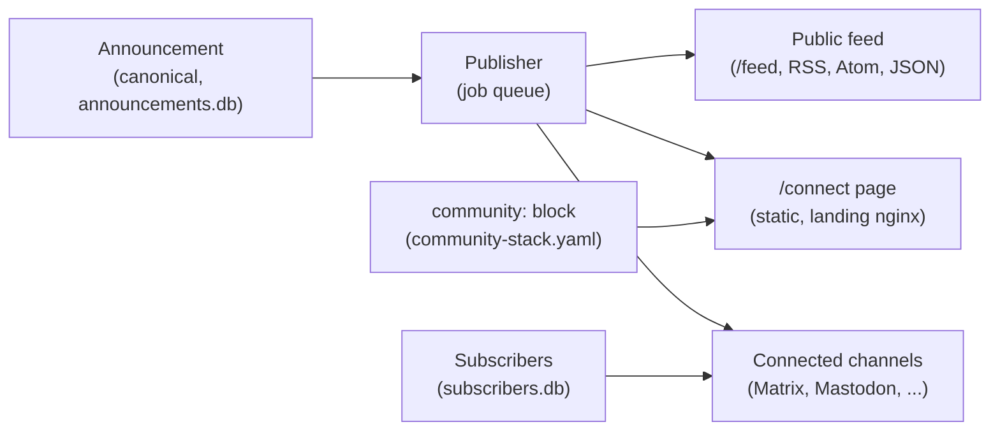

# Communication Resilience: Architecture

Status: CR0 design, with CR1 implemented and CR2.1 done. Full plan:
[COMMUNICATION_RESILIENCE_ROADMAP.md](COMMUNICATION_RESILIENCE_ROADMAP.md).
Decisions: [ADR 0008](decisions/0008-communication-resilience.md).

## Goal
A community keeps the reach of proprietary networks and can still reach its
members when one of them goes away. Members set up independent channels
voluntarily, before anything goes wrong.

## Architecture

- **Canonical content.** Announcements are written to `announcements.db`
  before anything is sent. Every channel is an output of that store.
- **Identity.** The `community:` block holds the name, URL, logo, contact,
  emergency note and social accounts. It is optional, and defaults keep older
  configurations working.
- **Channels on `/connect`.** Only channels that are switched on and actually
  connected are listed. Anything else is hidden, and `connect show` says why.
- **Refresh.** The publisher rebuilds `/connect` after every publish, edit or
  withdrawal, whether or not a channel accepts the job.

## Data ownership

| Data | Where | Public? |
| --- | --- | --- |
| Profile and channel switches | `community-stack.yaml` | Yes, shown on `/connect` |
| Announcements and delivery history | `data/announcements/announcements.db` | Published items only |
| Subscribers (phone numbers, addresses) | `data/announcements/subscribers.db` | Never |
| Logo | Next to the config file, re-encoded without metadata | Yes |
| Offline package | `backups/`, built on demand | Public data only |

## Security and privacy
- Subscriber data never appears in feeds, `/connect`, `community.json` or
  archives. A test enforces the last one.
- The page has no JavaScript and loads nothing from outside the stack.
  All profile text is HTML-escaped.
- Logos are re-encoded to remove metadata such as GPS location. SVG is not
  accepted, because the page shares an origin with `/admin`.
- The page is rebuilt from validated configuration. A broken configuration
  leaves the last good page in place and logs a warning. Delivery is unaffected.

## Phase status

| Phase | State |
| --- | --- |
| CR0 design | This document and ADR 0008. D1 and D2 accepted; D3 open |
| CR1 `/connect`, QR codes, identity package | Implemented. Console profile editing (CR1.8) is not built |
| CR2.1 one subscriber list | Implemented |
| CR2.2 onward (consent, email, sign-up) | Not started; waits on D3 for public wording |

## Dependencies between phases
CR2 depends on CR1 for the sign-up links and channel explanations. CR4 depends
on CR1 to CR3 for the public notice, the channel states and the social
messages. CR6 starts only after CR0 to CR5 are stable.
