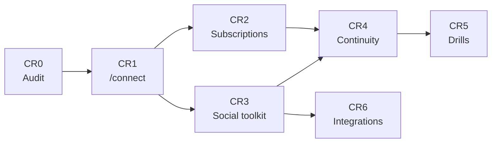

# Communication Resilience Roadmap

As of 2026-11-01, audited against commit `7928382`. Audience: maintainers and
the coding agents implementing this work.

Communities should keep the reach of proprietary social networks and still be
able to contact their members if a network goes down, restricts access, changes
its policies or disappears. Members set up an independent channel before a
disruption happens, by choice and at their own pace. Community Stack becomes the
stable, community-controlled source of truth. It does not become a generic social
media management platform.

This roadmap adds a **CR** track alongside the tracks in
[ROADMAP.md](ROADMAP.md). Its phases are numbered CR0 to CR6 so they do not
collide with that document's phases.

## 1. How to work through this roadmap

- Work in order: finish CR0, then all of CR1. Do not start later phases until
  CR1 is working, tested, documented and reviewed.
- Each phase ships on its own and merges only when its exit criteria pass.
- Task IDs (`CR1.4`) are the unit of work. Tick a task only after it has been
  tested. Never describe a feature as implemented before that.
- Extend existing components before adding new ones. Avoid new dependencies and
  services. Do not add a database or web application unless CR0 shows the
  existing architecture cannot do the job.
- Every phase must also meet the checklist in section 13.

After each phase, report:

1. What was implemented.
2. Which existing components were reused.
3. New dependencies, if any, and why they were necessary.
4. Tests executed and their results.
5. Security and privacy implications.
6. Remaining limitations.
7. The recommended next step.

## 2. Principles

1. **Community-owned identity.** Each community has a stable URL on its own
   domain, independent of any social platform.
2. **Canonical content.** Important announcements are created and stored in
   Community Stack before going anywhere else.
3. **Multi-channel by design.** No important information exists only on a
   proprietary network.
4. **Voluntary migration.** Social followers are never added to any list.
   Independent subscriptions need explicit consent.
5. **Low-friction adoption.** Independent channels are useful every day, not
   just as an emergency backup.
6. **Graceful degradation.** Core functions keep working without external social
   APIs or services.
7. **Open formats and portability.** Content, subscription records, configuration
   and archives export in documented formats.
8. **Privacy by default.** Collect as little as possible. Never scrape followers
   or contacts.

## 3. Where the repository stands

This audit comes from reading the code, not from testing live services. CR0.1
must confirm it.

| Area | What exists | Gap |
| --- | --- | --- |
| Announcements | Full lifecycle, review, urgent publishing, templates, scheduling, media, per-channel text (`channel_text`), job queue with retries (`announcements/publisher.py`, `storage.py`) | One image per announcement; no manual publication states |
| Public site | Generated HTML, RSS, Atom and JSON Feed under `/feed` (`adapters/web_feed.py`), served by nginx | No `/connect`; `index.html` and `lite.html` are fixed files with no community identity |
| Community identity | `project.name` (a lowercase slug) and `domain.web` | No display name or profile; public pages print the slug |
| Automatic channels | Mastodon, Bluesky, Telegram, Matrix, Discord, Slack, listmonk, SMS, Signal, WhatsApp bridge, Facebook, Instagram, Threads and a native fediverse actor (`connectors.py`, `fediverse.py`) | Tested against recorded API behaviour, mostly not live accounts |
| Email | Delivery through listmonk only | No native sending and no public email sign-up |
| Subscribers | `SubscriberManager` with status and topics; public `/subscribe` flow for SMS only | No consent record, export, deletion or console page |
| Offline | `OfflineArchiveExporter` zip with checksums; `archive export` and `verify` | No identity, channel instructions or QR codes |
| Continuity | The `continuity/` package holds only the exporter | No channel states, continuity mode, or drills |
| Audit | Console and agent audit logs (`record_event`) | Only `admin` CLI commands write to it; `announce` and `subscribers` do not |

### Findings that shape the plan

1. **Native email is not usable.** `EmailNewsletterAdapter` is not wired to any
   connector and has no SMTP code. Without a test transport it reports success
   and sends nothing. It also sends one message to all recipients, so it cannot
   carry a per-person unsubscribe link.
2. **The CLI and publisher use different subscriber databases.** The CLI opens
   `data/subscriptions/subscribers.db`. The publisher and SMS sign-up use
   `data/announcements/subscribers.db`. Fix this first in CR2.
3. **Consent is not provable.** `add_subscriber` activates and reactivates
   addresses immediately and stores no consent timestamp or text. The CLI command
   `subscribers add` bypasses confirmation entirely.
4. **Automatic adapters are ahead of the original plan.** Meta, Mastodon and a
   native ActivityPub actor already exist. The remaining work is live acceptance,
   not new adapters.
5. **Manual publishing does not exist.** Delivery records only know `delivered`,
   `failed` and `withdrawn`. WhatsApp has no official publishing API here, so the
   target scenario in section 15 depends on manual publishing.
6. **The console's config path handles scalars only.** `config_edit.set_value`
   and the `Setting` catalogue cannot write lists or free text, and the
   announcements container mounts the YAML read-only. Profile editing needs a new
   agent operation.
7. **There is no migration framework.** Tables are created with
   `CREATE TABLE IF NOT EXISTS` and evolved with `PRAGMA table_info` plus
   `ALTER TABLE` in `_init_db`. New tables and columns follow that pattern.
8. **Backups copy `subscribers.db` as a live file.** Only `announcements.db` gets
   a consistent SQLite snapshot in `backup.py`.
9. **Some public claims and docs are wrong.** The offline archive footer says
   "Cryptographically Verified", but it only has SHA-256 checksums inside the same
   zip. `docs/accessible-channels.md` still describes SMS as planned and ActivityPub
   as an unwired prototype. The `emergency-banner` in `index.html` is hidden and
   nothing can show it.

## 4. Design decisions

These follow from the audit. CR0.4 records them in an ADR, and they stand unless
CR0 finds a reason to change them.

- **`/connect` is a generated static page.** It is written to
  `data/landing/connect/` and served by the landing nginx, so it stays up when the
  announcements app is down. Caddy's default route already reaches nginx, so no
  new route should be needed. CR0.1 confirms this against production.
- **All dynamic public routes stay under `/subscribe*`.** That route already
  exists, and `scripts/deploy-vps.sh` preserves the production Caddyfile and
  patches it surgically. Avoiding new routes avoids new patching.
- **Identity lives in YAML, runtime state in SQLite.** The profile goes in
  `community-stack.yaml`. Channel states, continuity events and drills go in
  `announcements.db`. Subscribers stay in `subscribers.db`.
- **The profile stores only what cannot be derived.** The channel list comes from
  live connections, so a hand-kept flag can never advertise a channel that does
  not work. `community.url` defaults to `https://<domain.web>`.
- **The console and CLI have equal capability.** The target scenario must work
  without a developer, and [ROADMAP.md](ROADMAP.md) says nothing is configurable
  in only one of them. Every `community-stack` command below needs a console
  equivalent backed by the same engine code.
- **No new dependencies are expected.** `segno` (already used for TOTP) covers QR
  codes, `jinja2` covers templates, `smtplib` covers email, and printable HTML
  stands in for PDF.
- **Native email is the default; listmonk stays optional.** See decision D1 in
  section 16.

## 5. Phase overview

| Phase | Outcome | Depends on | Priority |
| --- | --- | --- | --- |
| **CR0** Audit and architecture | Verified audit and approved design | Existing code | P0 |
| **CR1** Identity and `/connect` | One stable URL lists every official channel | CR0 | P1 |
| **CR2** Independent subscriptions | People join by email without an account | CR1 | P2 |
| **CR3** Social distribution | Manual publishing is prepared and tracked per platform | CR1 | P3 |
| **CR4** Continuity mode | An administrator can redirect members in minutes | CR1, CR2, CR3 | P4 |
| **CR5** Adoption and drills | Readiness is measured and rehearsed | CR4 | P5 |
| **CR6** Further integrations | Added only on proven demand | CR3 | P6 |



CR2 and CR3 can run in parallel once CR1 is reviewed.

## 6. CR0: Audit and architecture

**Goal:** replace assumptions with verified facts and agree the design.

- [ ] **CR0.1 Verify the audit.** Check section 3 against the code and record a
  `uv run pytest` baseline. Cover the announcement lifecycle and storage, portal
  and feed generation, Matrix and other adapters, subscribers and consent, backups
  and offline archives, CLI and config conventions, and deployment and Ansible.
- [x] **CR0.2 List documentation discrepancies.** Note where the README and docs
  differ from the code, and correct anything that misleads operators, starting
  with `docs/accessible-channels.md`.
- [x] **CR0.3 Write `docs/COMMUNICATION_RESILIENCE.md`.** Keep it short. Cover the
  proposed architecture, data ownership and canonical content flow, new data
  models and configuration, phase dependencies, and security and privacy.
- [x] **CR0.4 Write `docs/decisions/0008-communication-resilience.md`.** Record
  section 4 and the resolved open decisions from section 16.
- [x] **CR0.5 Reconcile with `docs/ROADMAP.md`.** Link this track from it, and
  update B8 and the email connector row to match decision D1.

**Exit criteria**

- Every finding in section 3 is confirmed or corrected.
- Maintainers have approved the design document and D1 to D3.
- Any new service or database has a written justification.

## 7. CR1: Identity and `/connect`

**Goal:** a permanent public page that works as the community's independent
communication hub.

### Configuration target

Add an optional block, following existing conventions:

```yaml
community:
  name: "Example Community"
  description: "A community working together."
  url: "https://community.example.org" # optional; defaults to https://<domain.web>
  logo: "logo.png"
  cover: "cover.jpg"
  languages: ["en"]
  contact:
    email: "hello@example.org"
  emergency_instructions: "If this site is unreachable, ..."
  social:
    - platform: instagram
      url: "https://instagram.com/example"
      handle: "@example"
    - platform: facebook
      url: "https://facebook.com/example"
  # Show or hide channels that are configured. This cannot make a channel work.
  independent:
    website: true
    email: true
    matrix: true
    activitypub: false
    rss: true
```

### Tasks

- [x] **CR1.1 Extend the schema.** Add `community` to `config/schema.json` (the
  root sets `additionalProperties: false`) and `config/example.yaml`. Validate URLs
  and supported platform and channel types. Keep the block optional, so existing
  configs stay valid and fall back to `project.name` and `domain.web`.
- [x] **CR1.2 Add a profile loader.** Create `cli/community_stack/community.py`
  and use it in place of the `project.name` lookups in `publisher.py` and
  `admin/app.py`. Pass it to `OfflineArchiveExporter` too, which `archive export`
  currently runs with a placeholder name.
- [x] **CR1.3 Resolve independent channels.** Build the list from what is really
  available: website, RSS, Atom, JSON Feed, `/subscribe`, Matrix, ActivityPub.
  Apply the `independent` show/hide overrides. List Matrix only when people can
  actually join it, given federation and registration settings.
- [x] **CR1.4 Render the page.** Add `continuity/connect_page.py` with a Jinja2
  template that writes `data/landing/connect/index.html`. The page introduces the
  community, separates social networks from independent channels, gives subscription
  links, shows recent public announcements, and explains where to find the community
  if a platform becomes unavailable.
- [x] **CR1.5 Serve it.** Mount `data/landing/connect` read-only in the landing
  compose file and writable in the announcements compose file. Create the directory
  with the right owner during provisioning and deployment, because Docker would
  otherwise create it as root. Check that `/connect` and `/connect/` both end on
  the HTTPS page.
- [x] **CR1.6 Add rebuild triggers.** Rebuild after publish, update and withdraw,
  after a profile save, and at worker start. Trigger from the publisher so the page
  does not depend on the `web_feed` channel being enabled.
- [ ] **CR1.7 Handle images.** Process logo and cover uploads through
  `announcements/media.py`, which strips metadata. Accept raster formats only until
  SVG sanitising exists, because the page shares an origin with `/admin`.
  Open: the logo is re-encoded, but the announcements container cannot read it
  from the host, so it is left out of pages the container rebuilds (see deployment.md).
- [x] **CR1.8 Add console editing.** Add a Community profile page and a structured
  agent operation that validates against the schema, backs up, rewrites only the
  `community:` block, and writes an audit event. Require the `settings` permission.
- [x] **CR1.9 Add QR codes.** Generate SVG and PNG with `segno`, defaulting to
  `<community.url>/connect` with a configurable destination. Include a quiet zone
  and print-suitable sizing. Warn if the destination is outside `domain.base`, since
  a hosting-provider URL would not survive a migration.
- [x] **CR1.10 Add the CLI.** Add `commands/connect_cmd.py` with `connect show`,
  `connect generate-qr` and `connect export`.
- [x] **CR1.11 Extend the offline archive.** Add the page, QR codes and a
  machine-readable `community.json` to `OfflineArchiveExporter`, using relative links.
  Replace the "Cryptographically Verified" footer with an accurate statement.
- [x] **CR1.12 Link the portal.** Link `/connect` from `index.html`, `lite.html`
  and announcement pages.
- [x] **CR1.13 Update documentation.** Update `README.md`, `docs/operations.md`,
  `docs/deployment.md`, `docs/backup-restore.md` and `CHANGELOG.md`.

### Page requirements

Mobile-first and accessible to WCAG 2.2 AA. No JavaScript needed for essential
functions. Fast and low-bandwidth. No external assets, tracking or advertising.
Printable layout. Clear, plain language.

### Tests

- Unit: valid config, invalid URL, unknown platform, missing `community` block.
- Unit: rendered output escapes profile text, contains no `<script>`, and references
  no external hosts for page assets.
- Unit: generated SVG parses and PNG opens with Pillow.
- Integration: rebuild triggers, compose mounts in `test_compose_configs.py`, and
  `archive verify` on an archive containing the page.
- End-to-end: fetch `/connect` through Caddy on staging with JavaScript off, stop
  the announcements container, and confirm the page still loads.
- Manual: scan a printed QR code with one iPhone and one Android camera.

### Exit criteria

- A community can configure its identity without modifying source code, from both
  the console and the YAML file.
- The public page works without JavaScript.
- All official channels are discoverable from one stable URL.
- The page can be regenerated and is included in offline archives.
- QR codes work with ordinary smartphone cameras.

## 8. CR2: Independent subscriptions

**Goal:** someone who finds the community on Instagram can subscribe to independent
announcements in under a minute, without creating an account.

### Tasks

- [x] **CR2.1 Unify the subscriber database.** Point the CLI at
  `data/announcements/subscribers.db` and merge any rows from the old path without
  overwriting existing records. This is a bug fix and can ship ahead of the phase.
- [x] **CR2.2 Record consent.** Add a `pending` status and columns for consent
  timestamp, consent version and source, and confirmation timestamp. Store the full
  text of each consent version. Mark existing rows `legacy` and do not invent
  timestamps for them.
- [x] **CR2.3 Complete the lifecycle.** Implement subscribe, confirm, unsubscribe,
  resubscribe, change preferences, export and delete in `SubscriberManager`.
  Resubscribing needs fresh confirmation. `subscribers add` for email must send a
  confirmation request or require a stated consent source. Purge unconfirmed entries
  after a short period.
- [x] **CR2.4 Add a pluggable email transport.** Define a transport interface with
  an SMTP implementation built on `smtplib`, and add an `email` connector with its
  credentials stored as a channel connection. Remove the silent success: with no
  transport, delivery must fail.
- [x] **CR2.5 Send per recipient.** Give each message a signed unsubscribe link and
  RFC 8058 headers. Add a send ledger keyed by announcement, operation and subscriber
  so a retry skips people already mailed. Send in batches that fit the 5-minute job
  lease, or renew the lease.
- [x] **CR2.6 Build the public form.** Rework `/subscribe` into a page offering
  email, SMS and feeds, with a mail address field, preference choice, unticked consent
  box and privacy notice. Reuse the existing CSRF, honeypot and hashed rate-limit
  approach, limited per address and per client. Give the same response whether or
  not an address is known. It must work without JavaScript.
- [x] **CR2.7 Make links safe.** Confirmation GETs show a button and only a POST
  confirms, because mail scanners follow links. Tokens are hashed and expire. One-click
  unsubscribe accepts a token POST with no CSRF cookie, because mail clients send
  none.
- [x] **CR2.8 Add preferences.** Offer all public announcements, important only, and
  events. Map these to reserved `important` and `events` announcement tags, and add
  matching controls to the editor. Add a token-based page for managing preferences.
- [x] **CR2.9 Explain the channels.** On `/connect` and `/subscribe`, describe email,
  SMS, RSS and Atom, JSON Feed, Matrix and ActivityPub in plain language for
  non-technical readers.
- [x] **CR2.10 Add administration.** Add a console Subscribers page with masked
  addresses and aggregate counts, plus audited export and deletion. Add
  `subscribers export` and `subscribers delete` to the CLI.
- [x] **CR2.11 Fix backups.** Snapshot `subscribers.db` consistently, as
  `announcements.db` already is, and add a restore test.
- [x] **CR2.12 Handle listmonk overlap.** Warn when native email and listmonk are
  both connected, since members could be mailed twice.
- [x] **CR2.13 Help with deliverability.** Add a test-send button and SPF, DKIM and
  DMARC guidance. Send no tracking pixels.
- [ ] **CR2.14 Write the privacy wording.** Publish a notice that names the community
  from its profile, states what is stored and why, and explains how to leave. Have the
  consent and notice text reviewed against GDPR and French electronic communications
  rules.

### Tests

- Unit: each lifecycle transition, token expiry and reuse, and preference filtering.
- Integration: the full flow with a fake SMTP server, covering confirm, receive,
  one-click unsubscribe and resubscribe.
- Integration: a retry after partial failure mails nobody twice.
- Integration: rate limits, honeypot, CSRF, and identical responses for known and
  unknown addresses.
- Integration: a scanner-style GET does not confirm or unsubscribe.
- Integration: subscriber data appears in no feed, archive or public page.
- Recovery: restore a backup and check subscribers and consent records survive.
- Manual: deliver to at least two real mail providers through a real relay.

### Exit criteria

- A person coming from Instagram can subscribe in under a minute, on a phone, without
  creating an account.
- Subscription keeps working with every social network unavailable.
- Each confirmed subscriber has a consent record, and every email has a working
  unsubscribe link.
- Export and deletion work from the console and the CLI.

## 9. CR3: Social distribution toolkit

**Goal:** an administrator prepares one canonical announcement, generates platform
variants, publishes them by hand, and always knows which channels received it.

Start with manual publishing. Do not try to automate every platform.

### Tasks

- [ ] **CR3.1 Add a platform catalogue.** Create `announcements/platforms.py` with
  each platform's identifier, name, capabilities, character limits, supported media
  and publication modes, reusing `ChannelCapabilities`. Per-community details (account
  URL, handle, adapter configuration, enabled state) stay in `community.social` and
  channel connections. None of this goes in the `Announcement` model.
- [ ] **CR3.2 Prepare per-platform content.** Build on `channel_text` to generate
  adapted text with a shortened description, canonical URL, suggested hashtags and a
  call to action pointing to independent channels. Add per-channel media. Keep generated
  text editable, and avoid identical copy on every platform.
- [ ] **CR3.3 Add a manual adapter.** Add a `ManualChannelAdapter` that reuses the
  connector's channel name, so a platform's text and history carry over if it is
  automated later. Add a `prepared` outcome to `DeliveryResult`.
- [ ] **CR3.4 Extend delivery states.** Add `prepared` and `unknown` to
  `delivery_states`, and a column for who recorded the result. Show the four states
  Prepared, Published, Failed and Unknown in the console, with `delivered` displayed
  as Published. Only an explicit administrator action sets a manual channel to
  published, with its post URL and timestamp.
- [ ] **CR3.5 Build the console workflow.** On the announcement page, show each
  platform's text and media, a copy-to-clipboard button, a link to the official
  platform, and actions to record the outcome. Text must remain selectable without
  JavaScript. Opening a link changes nothing.
- [ ] **CR3.6 Cover edits and withdrawals.** When a published announcement changes
  or is withdrawn, create a visible task for each manual channel.
- [ ] **CR3.7 Add the CLI.** Add commands to list publications for an announcement
  and record an outcome.
- [ ] **CR3.8 Review automatic adapters.** Confirm each one is independently
  configurable, fails without affecting others, retries appropriately, declares its
  capabilities and limitations, and is never needed for core functions. Record its
  live-acceptance status. Add no new automatic adapters in this phase.

Use official APIs only. Scraping, browser automation that violates platform terms,
and unofficial APIs must never be core dependencies.

### Tests

- Unit: catalogue validation and length limits per platform.
- Integration: one announcement with mixed automatic and manual channels, where
  one automatic channel fails.
- Integration: manual channels stay `prepared` until recorded, and opening a platform
  link never changes state.
- Integration: withdrawal creates a task for each manual channel.

### Exit criteria

- One canonical announcement produces platform-specific variants.
- An administrator can publish them manually and record the results.
- The console shows, per channel, whether an announcement was prepared, published,
  failed or unknown.

## 10. CR4: Continuity mode and migration toolkit

**Goal:** an administrator activates continuity mode in a few minutes and members
immediately get accurate instructions for finding the community elsewhere. This is
what separates Community Stack from a conventional multi-channel publisher.

### Tasks

- [ ] **CR4.1 Add channel states.** Add a table recording operational, degraded,
  unavailable or retired, with reason, time and actor, for social and independent
  channels. States are set manually. Never infer them from API availability, because
  account restrictions, moderation and local blocking differ from platform outages.
  Show them on `/connect`.
- [ ] **CR4.2 Add continuity events.** Add an append-only table of activations and
  deactivations, with time, actor, reason and affected channels.
- [ ] **CR4.3 Build the continuity service.** Add `continuity/service.py`, used by
  both CLI and console. Activation records the event, updates affected channels,
  shows the public notice, publishes to independent channels, prepares social messages,
  and generates the guide. Each step is idempotent and logged, so a failed step can
  be resumed and cannot block the others. Normal publishing and archiving keep
  working throughout.
- [ ] **CR4.4 Add the migration template.** Seed a template covering what happened,
  which channels are affected, where to reach the community, the canonical URL, how
  to join independent channels, and the date and time of the update. Support each
  language in `community.languages`. Publish through the existing urgent path, and
  only to channels not marked affected.
- [ ] **CR4.5 Show the public notice.** Display it on `/connect` and on the home page.
  `index.html` is a read-only shipped file, so replace the dead `emergency-banner` with
  a mechanism that needs no JavaScript.
- [ ] **CR4.6 Build the offline continuity package.** Add `continuity/package.py`
  producing a zip with identity and contacts, official channel URLs, independent channel
  instructions, latest important announcements, emergency procedures, QR codes, a
  printable HTML guide, and JSON data. Reuse the manifest and `archive verify`. Publish
  the guide as a downloadable contact and communication guide. Never include subscriber
  data.
- [ ] **CR4.7 Add commands and console controls.** Add `continuity status`, `plan`,
  `activate` and `deactivate`, plus a console page with password re-confirmation for
  owners and admins. `plan` previews everything activation would do. Both surfaces write
  to the audit log.
- [ ] **CR4.8 Make it reversible.** Deactivation removes the notice and keeps the
  history. Nothing in this phase deletes, disconnects or retires a social account
  automatically.
- [ ] **CR4.9 Document the failure of your own server.** `/connect` depends on the
  community's domain and host. Document the operator runbook, the standby host in
  `docs/multi-host-resilience.md`, and how to distribute the offline package in advance.

### Tests

- Unit: state transitions, and the template rendering each language.
- Integration: activate, resume after an injected step failure, and deactivate.
- Integration: `channel_connections` is unchanged after activation and deactivation.
- Integration: the continuity announcement skips affected channels and survives a
  failing adapter.
- Integration: activation and deactivation appear in the audit log from both surfaces.
- Integration: seeded subscriber addresses appear nowhere in the package.
- End-to-end: on staging with social APIs unreachable, activate from the console,
  then confirm the notice on `/connect` with JavaScript off.

### Exit criteria

- An administrator can activate continuity mode in a few minutes and immediately give
  members accurate instructions.
- Public community information remains available when external services are unavailable.
- Continuity mode is reversible and fully audited.
- The offline package can be printed or stored on removable media and contains no
  private subscriber data.

## 11. CR5: Adoption and continuity exercises

**Goal:** a community can regularly verify its independent infrastructure without
taking its social accounts offline.

### Tasks

- [ ] **CR5.1 Add aggregate metrics.** Show confirmed independent subscribers, active
  independent channels, percentage of announcements distributed independently, last
  successful independent publication, and announcements in the offline archive. Do not
  track individuals across platforms or estimate follower counts by scraping.
- [ ] **CR5.2 Add the readiness check.** Add `continuity check` and
  `continuity report`, with a console view. Find missing stable URLs, missing independent channels,
  missing or untested subscription workflows, channels with no recent successful
  publication, incomplete offline archives, and missing emergency instructions. Give a
  specific recommendation for each finding, with no overall score.
- [ ] **CR5.3 Add migration drills.** Add a `continuity_exercises` table and drill
  commands with console equivalents. A drill generates a simulated outage announcement,
  publishes it to selected independent channels, asks administrators to verify access,
  records the date and results, and produces a short report of problems found.
- [ ] **CR5.4 Keep drills safe.** Apply the simulation label in the renderer on every
  output, so that it cannot be edited out. Drills never change channel states or activate
  continuity mode.

### Tests

- Unit: each readiness rule, with passing and failing fixtures.
- Unit: metrics contain only aggregates.
- Integration: every drill output carries the simulation label, and a drill changes
  no channel state.

### Exit criteria

- A community can verify its independent communication infrastructure periodically
  without taking its social accounts offline.
- The report gives recommendations an administrator can act on.
- Simulated announcements cannot be mistaken for real emergencies.

## 12. CR6: Further integrations

Start only after CR0 to CR5 are stable. Do not let the project become a collection
of fragile social network connectors.

Accept an integration only with a written case covering actual demand, API stability,
maintenance burden, and its effect on community autonomy.

| Candidate | Starting point |
| --- | --- |
| Automatic Meta publishing | Code exists; needs live acceptance and token refresh |
| Deeper ActivityPub integration | Native actor exists |
| Email-to-Matrix or Matrix-to-email workflows | Not started |
| Additional messaging platforms | Follow the rules in CR3.8 |
| Importing community-owned contacts | Needs proof of consent per contact |
| Event calendar subscriptions (iCalendar) | Not started |
| Additional offline synchronization | Builds on the CR4.6 package |

## 13. Requirements for every phase

**Data and compatibility**

- [ ] Existing configs keep working, and schema changes are validated.
- [ ] Persistent changes follow the `_init_db` pattern and are tested against an
  older database.
- [ ] New data is included in exports, and its backup and restoration are documented
  and tested.

**Privacy and consent**

- [ ] Never scrape followers or private conversations.
- [ ] Never subscribe anyone based on social network interactions.
- [ ] Email and other direct notifications require explicit consent, with unsubscribe
  and deletion available.
- [ ] Private subscriber data never reaches public feeds, pages or archives.

**Security**

- [ ] Public endpoints are protected against spam and abuse.
- [ ] Credentials never appear in files committed to Git.
- [ ] Continuity activation and administrative actions are auditable.

**Reliability**

- [ ] One external service failing cannot block independent publication.
- [ ] Core functions work without external APIs.

**Delivery**

- [ ] Unit, integration and end-to-end tests pass, with
  `uv run pytest`, `uv run ruff check .` and `uv run ruff format --check .` clean.
- [ ] Documentation, examples and `CHANGELOG.md` are updated.
- [ ] The console and CLI offer the same capability.

## 14. Data model

These are conceptual requirements. Confirm the mapping in CR0.

| Entity | Purpose | Where it lives |
| --- | --- | --- |
| CommunityProfile | Canonical identity and configuration | `community:` in YAML (CR1) |
| ExternalChannel | Social account or external channel | `community.social` plus the catalogue (CR3) |
| IndependentChannel | Community-controlled endpoint | Derived from connections, with overrides (CR1) |
| Subscription | Explicit relationship between a person and a channel | Extended `subscribers` table (CR2) |
| Publication | Record of an announcement on a channel | Extended `delivery_states` and `delivery_attempts` (CR3) |
| ContinuityEvent | Activation and deactivation history | New table in `announcements.db` (CR4) |
| ContinuityExercise | Record of a simulated exercise | New table in `announcements.db` (CR5) |

Keep these distinctions in the data model:

- An announcement is not a publication.
- A social account is not an independent communication channel.
- A follower is not a subscriber.
- A channel being operational does not mean every member can access it.
- A publication being prepared does not mean it was published.

## 15. Definition of done

The track succeeds when this scenario works from start to finish, with no developer
involved:

| # | Scenario step | Delivered by |
| --- | --- | --- |
| 1 | A community uses Instagram, Facebook and WhatsApp as its primary public channels | Starting point |
| 2 | It creates its canonical identity page through Community Stack | CR1 |
| 3 | Its social profiles link to that page | CR1 |
| 4 | Visitors subscribe to independent announcements without creating an account | CR2 |
| 5 | New announcements are published on the website and independent channels, and prepared for social publication | CR2, CR3 |
| 6 | The community gradually builds an independent audience | CR2, CR5 |
| 7 | Its primary social network becomes unavailable | Trigger |
| 8 | An administrator activates continuity mode | CR4 |
| 9 | Members immediately find the new channels through the stable URL | CR1, CR4 |
| 10 | Announcements, contact instructions and essential information stay accessible | CR1, CR4 |
| 11 | The community keeps operating without rebuilding its infrastructure | All |

Run this scenario on a staging instance as the final acceptance test.

## 16. Open decisions and risks

Resolve these in CR0.

- [ ] **D1. Email engine.** Recommendation: build native double opt-in and SMTP
  sending, and keep listmonk as an optional connector. Consent then stays in the
  community's own data, and `/subscribe` works with no extra service. This changes the
  listmonk-first plan in [ROADMAP.md](ROADMAP.md), so maintainers need to approve it.
  A relay account remains an external dependency, but it can be swapped.
- [ ] **D2. Public page languages.** Recommendation: keep public text in one catalogue
  from CR1 and ship English first. Decide whether French must ship in CR1 for the first
  communities. Full interface translation stays out of scope.
- [ ] **D3. Legal review.** Decide who reviews the consent and privacy wording in
  CR2.14. Engineering cannot sign this off alone.

| Risk | Mitigation |
| --- | --- |
| `/connect` shares a domain and host with the rest of the stack | Static page, standby host, offline package distributed in advance (CR4.9) |
| Email is delivered to spam or the relay account is lost | Deliverability checks, swappable transport, feeds as a fallback |
| Sign-up form used to mail-bomb third parties | Per-address and per-client limits, neutral responses (CR2.6) |
| Administrators mark posts published without posting | Record the post URL and actor; treat the record as an operator claim |
| Drill mistaken for a real emergency | Renderer-enforced label (CR5.4) |
| Scope drifts into social media management | CR6 intake rule; manual publishing stays first-class |
