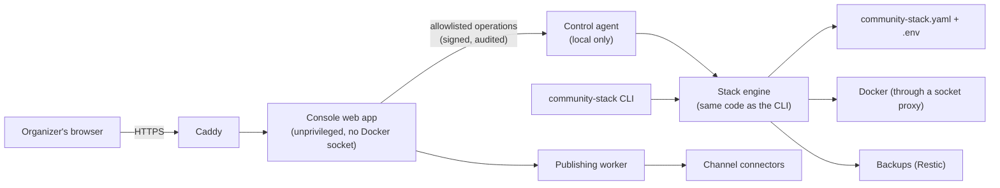
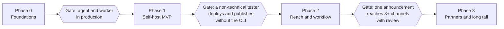

# Community Stack Roadmap

As of 2026-10-30. Audience: maintainers, contributors and hosting partners.

The goal of this roadmap is that an organizer with no server experience can
deploy the stack, switch services on, and publish one announcement to every
channel their community uses, entirely from a browser. Three tracks get us
there: an **administration console** (Track A), **better publishing tools**
(Track B) and **more connectors** (Track C). They ship together in four phases,
each phase ending in a release that a non-technical operator can use on its own.

Decisions already taken:

- **Two operating models.** Communities self-host their own instance, and
  hosting partners (tech collectives, NGOs) can run many instances. Self-hosting
  ships first; partner tooling builds on it.
- **Hybrid build.** We build the console, the canonical publishing pipeline and
  the connectors for open protocols. We integrate proven open-source tools
  (listmonk, Ketesa, an SMS gateway) as optional services where they fit.
- **All four channel families are in scope:** open social web (fediverse,
  Bluesky), messaging (Telegram, Signal), Meta platforms, and email/SMS. They
  are sequenced by access hurdles, not by importance.
- **English-only interface at launch,** built on a translation framework so
  other languages can be added later.

---

## 1. Goals and principles

Success means three things:

1. **Run the stack without the CLI.** Enable, configure, provision, back up,
   update and restore services from the admin console.
2. **Publish once, reach everywhere.** A shared editor with drafts, scheduling,
   media, review and per-channel previews.
3. **Reach people where they are.** Connectors for the open social web first,
   then the commercial platforms communities actually use.

Every track must respect these principles:

- **One source of truth.** The console and the CLI drive the same engine and the
  same `community-stack.yaml` plus `.env`. Nothing is configurable in only one
  of them.
- **Least privilege.** The public web app never gets the Docker socket or the
  full secrets file. Privileged actions go through a narrow, audited local
  agent.
- **Every change is reversible.** A change is validated, backed up, applied,
  health-checked, and rolled back automatically on failure.
- **Zones stay separate.** Public announcements, open community chat and
  internal coordination stay isolated. Connectors only ever carry public
  content.
- **The canonical copy stays home.** Commercial networks are outlets. The stack
  keeps the authoritative copy, so losing an account never loses history.
- **Plain language and accessibility.** Task-based screens, no jargon, WCAG 2.2
  AA, usable by keyboard and screen reader.

## 2. Where the stack is today

The fresh-VPS acceptance drill was run on 2026-10-30, and the latest Matrix and
WhatsApp admin changes are deployed to the VPS. The user confirmed the drill
passed the Phase 1 acceptance criteria.

| Area | Today | Remaining gap for a non-technical operator |
| --- | --- | --- |
| Deployment | `bootstrap.sh` and `deploy-vps.sh` cover fresh setup and code deployment; the VPS acceptance drill passed | Keep the passing acceptance flow as the release baseline |
| Service management | The admin console uses a privileged agent for service settings; Matrix connections and opt-in WhatsApp bridge provisioning are available in the UI | Record live service setup results; the WhatsApp bridge still requires account pairing and is not one-way |
| Admin console | `/admin` includes role-based accounts, two-step login, audit, service settings, health, backups, Matrix users, channels and mirroring | Verify the critical operator workflows in the acceptance checklist |
| Publishing | Drafts, templates, media, scheduling and a background delivery worker with retries are implemented | Expand coverage as Phase 2 adds reviewed publishing and more channels |
| Channels | The UI offers the web feed, Mastodon, Bluesky, Telegram, Matrix, Discord, Slack, email, SMS, Signal, WhatsApp, Facebook Pages, Instagram and Threads; Meta uses manually supplied access tokens | Track live acceptance per connector; Meta token issuance and refresh still happen outside the UI |
| Audience | Public subscription and confirmation pages are available | Verify real email/SMS delivery and unsubscribe behavior |
| Backups | Admin backup controls support encrypted/off-site configuration; deployment creates and verifies a pre-deployment backup | Record a restore test separately from backup creation |
| Continuity | Offline announcement archives can be downloaded from the admin console | Verify recovery and access to the restored archive during acceptance |

### Current decision point

**Phase 1 gate: PASSED (2026-10-30, user-confirmed).** The fresh-VPS setup,
browser-based configuration, five-channel publication, and backup/recovery
acceptance criteria passed. Phase 1 is complete; Phase 2 is active. The review
workflow (B5), templates (B6), and edit/withdraw lifecycle sync (B7) are already
implemented and covered by tests. The Services page also has pinned-version
updates (A6), and basic Matrix user management exists (part of A7, not Ketesa).
Facebook Pages, Instagram and Threads now have guided token-based setup in
Channels (A8); live account acceptance and automatic token refresh remain open.
The main Phase 2 gate is one reviewed announcement delivered to eight or more
configured channels, with withdrawal propagation checked.

## 3. Track A: Administration console

The console becomes the front door for everything the CLI does today. It is
split into an unprivileged web app and a small privileged agent, so that a bug
in the web app cannot become root on the host.

The console asks the agent for named operations such as "enable service X with
these settings" or "create backup". It never asks for raw commands. The agent
validates the request against `config/schema.json`, runs the same engine
functions as the CLI, and records the change in an audit log.

### A.1 Console security model

- **Allowlisted operations only:** no shell, no arbitrary Compose files, no
  free-form paths. Each operation has a typed schema.
- **The agent is local only.** It runs outside the public network (a Unix socket
  or a host-only port) and reaches Docker through a restricted proxy such as
  [docker-socket-proxy](https://github.com/Tecnativa/docker-socket-proxy).
- **Secrets are write-only in the UI.** They can be set or rotated, never
  displayed back. The console process never holds the full `.env`.
- **Re-authentication for dangerous actions:** disabling services, restoring,
  rotating secrets, connecting a new channel.
- **Every change runs the same pipeline:** validate → plan (diff shown to the
  user) → backup → apply → health check → automatic rollback on failure.

### A.2 Capabilities

| # | Capability | What the operator can do | Phase |
| --- | --- | --- | --- |
| A1 | First-run setup wizard | Check domain and DNS, set the admin email, create the first account, pick a profile, generate secrets, install. Replaces `init`, `check` and `install` | 1 |
| A2 | Service catalog | See each service with a plain description; enable, disable and configure it through forms generated from `config/schema.json`; preview the change before applying | 1 |
| A3 | Health and logs | Per-service status, disk space, certificate expiry, redacted logs, and the `doctor` checks as a "security status" page | 1 |
| A4 | Backups and recovery | Schedule backups, turn on Restic encryption, add an off-site S3 target with a wizard, run a restore drill, export the offline archive | 1 |
| A5 | Accounts, roles and audit | Several accounts with roles (Owner, Admin, Publisher, Reviewer), TOTP or passkey second factor, audit log of every change | 1 |
| A6 | Updates | See available pinned updates with release notes; one-click upgrade with automatic pre-backup and rollback | 2 |
| A7 | Matrix administration | Users, registration tokens, rooms and moderation, through [Ketesa](https://etke.cc/blog/introducing-ketesa/) as an optional service instead of rebuilding it | 2 |
| A8 | Channel connections | Connect, test and disconnect publishing channels, including guided "bring your own app" flows for Meta and X (Track C) | 1–2 |
| A9 | Login with Matrix account | Optional single sign-on for organizers through Matrix Authentication Service | 3 |
| A10 | Hosting-partner fleet view | One dashboard over many instances: health, versions, backups and updates, with each community's data kept separate | 3 |

### A.3 Getting non-technical users to the wizard

The first step, getting a server, is still the hardest. In order of effort:

1. **One-line bootstrap script** for any fresh Debian or Ubuntu VPS. It
   installs Docker and the agent, then prints the wizard URL and a one-time
   setup token.
2. **Pre-built VPS images** on providers' marketplaces, with the wizard on first
   boot.
3. **Hosting partners** provision the instance and hand the community a wizard
   link. This is the path for organizers who should never see a server at all.

## 4. Track B: Publishing tools

The editor grows from a plain-text form into a small newsroom. Publishing
moves into a background worker, which is what unlocks scheduling, reliable
retries and per-channel delivery.

| # | Capability | Detail | Phase |
| --- | --- | --- | --- |
| B1 | Background publishing worker | Durable job queue for publish, update, withdraw and retry, with per-channel rate limits and backoff. Prerequisite for B3 and all of Track C | 0 |
| B2 | Editor v2 | Markdown with live preview, links, headings and lists. Per-channel preview with character counters (Bluesky 300 graphemes, Threads 500, Telegram 4,096) and per-channel overrides | 1 |
| B3 | Scheduling | Publish at a set time in the community's time zone; edit or cancel scheduled items | 1 |
| B4 | Media library | Images and attachments with required alt text, automatic resizing per channel, and stripped EXIF metadata | 1 |
| B5 | Review workflow | Draft → In review → Approved → Scheduled → Published, using the roles from A5. Optional two-person rule. An "urgent alert" fast path for safety notices | 2 |
| B6 | Templates | Reusable templates for recurring formats such as meeting notices or alerts | 2 |
| B7 | Lifecycle sync | Edits and withdrawals reach every channel that supports them; where a channel can't edit (for example Bluesky), the UI says so before publishing | 2 |
| B8 | Public subscription page | Double opt-in sign-up for email and SMS with topic preferences and one-click unsubscribe, replacing the CLI subscriber list | 2 |
| B9 | Delivery insights | Per-channel delivery status (exists today) plus reach counts where the platform API offers them; no tracking pixels by default | 3 |
| B10 | Multilingual announcements | Language variants of one announcement, routed to channels per language. Content translation is separate from the English-only interface | 3 |

## 5. Track C: Connectors and social networks

The existing `ChannelAdapter` contract becomes a connector framework. Each
connector declares its **capabilities** (text limit, media, edit, delete,
scheduling, threads) so the editor can preview and warn. It stores its
**credentials** through the agent, never in YAML. And it exposes a **health
check** and a **guided connection flow** in the console.

Connectors are sequenced by how hard platform access is, not by how much they
matter. Open protocols ship first, then platforms behind app review.

| Channel | How it publishes | Access hurdle | Edit / withdraw | Wave |
| --- | --- | --- | --- | --- |
| Mastodon and compatible servers | [Statuses API](https://docs.joinmastodon.org/methods/statuses/): OAuth `write:statuses`, `Idempotency-Key`, native scheduling | Create an app on the community's account; no review | Edit and delete | 1 |
| Bluesky | [AT Protocol](https://bsky.network/docs/bluesky-api) `createRecord` with an app password, or OAuth | App password from account settings; no review | Delete only, no edit | 1 |
| Telegram channel | [Bot API](https://core.telegram.org/bots/api): bot added to the channel as an administrator | Create a bot with BotFather; no review | Edit and delete | 1 |
| Email newsletter | [listmonk](https://listmonk.app/) as an optional service, driven through its API; double opt-in lists | An SMTP provider and deliverability setup (SPF, DKIM) | Corrections sent as a follow-up email | 1 |
| Discord and Slack | Incoming webhooks | Paste a webhook URL | Discord: edit and delete; Slack: none | 1 (quick win) |
| Native ActivityPub actor | Finish the prototype: WebFinger, HTTP Signatures, followers inbox, so `@announcements@community` is followable from any fediverse server. Possibly via [Fedify](https://fedify.dev/) or an embedded server | None, but real implementation work | Update and Delete activities | 2 |
| Facebook Page | [Pages API](https://developers.facebook.com/docs/pages-api/manage-pages) with `pages_manage_posts` | Meta developer app; see the Meta note below | Edit and delete | 2 |
| Instagram | [Content Publishing API](https://developers.facebook.com/docs/instagram-platform/content-publishing) on a Professional account, 100 API posts per 24 h | Meta app plus a Professional account; image required | No edit or withdrawal through this API | 2 |
| Threads | [Threads API](https://developers.facebook.com/docs/threads/posts): container, then publish; 500 characters, 250 posts per 24 h | Meta app; Advanced Access needed beyond app testers | Delete only | 2 |
| SMS alerts | Gateway abstraction: an Android phone running [SMS Gateway for Android](https://hub.docker.com/r/capcom6/sms-gateway) (Apache-2.0) for small groups, commercial providers as plug-ins | Phone or provider account; per-message cost; explicit consent | Corrections sent as a follow-up | 2 |
| Signal group | [signal-cli-rest-api](https://github.com/bbernhard/signal-cli-rest-api) (unofficial) with a dedicated number | No official bot API; ban risk if traffic looks automated | Delete for everyone | 2, experimental |
| WhatsApp group | mautrix-whatsapp bridge; canonical announcements are sent to a linked Matrix portal room | Unofficial, account-ban risk; the bridge itself is bidirectional | Follow-up / notice | Early opt-in experiment; live acceptance pending |
| WhatsApp Channel | No official Meta API found; only third-party gateways such as [Whapi.Cloud](https://whapi.cloud/how-to-automate-whatsapp-channels-api) | Commercial gateway and a linked phone | Gateway-dependent | 3, watch |
| X | API v2 pay-per-use, reported at about $0.015 per post and $0.20 with a link ([vendor summary](https://postproxy.dev/blog/x-api-pricing-2026)) | Paid developer account, bring your own credentials | Delete only | 3, optional |
| LinkedIn, YouTube, TikTok, Pinterest | Optional bridge to a self-hosted [Postiz](https://github.com/gitroomhq/postiz-app) through its public API | Postiz's own requirements (Postgres, Redis, Temporal) | Postiz-dependent | 3, optional |

**The Meta note.** A Meta app in Standard Access can use permissions such as
`pages_manage_posts` for people who hold a role on that app, without App Review
([access levels](https://developers.facebook.com/docs/graph-api/overview/access-levels/)).
So a self-hosted community can create its own Meta app, add its organizers as
app admins, and publish to its own Page and Instagram account. The console will
walk them through it step by step. A hosting partner serving many communities
needs Advanced Access instead, which requires business verification and App
Review for each permission. That is one-time paperwork for the partner, not for
every community.

**Account-safety rules for unofficial channels** (Signal, WhatsApp): a dedicated
number, low volume, pinned client versions, a visible "experimental" label in
the console, and never enabled by default.

Some connectors, including WhatsApp, have been implemented ahead of their
planned wave as opt-in experiments. Being present in the console does not mean
they have passed live acceptance or are supported for production use.

## 6. Landscape: what to reuse or learn from

| Project | What it is | License | Role for us |
| --- | --- | --- | --- |
| [YunoHost](https://yunohost.org/) | Debian-based self-hosting distribution with a web admin and app catalog | AGPL-3.0 | UX reference for non-technical admins; possible extra distribution channel as a YunoHost app |
| [Cloudron](https://www.cloudron.io/) | Polished app platform with auto-updates and single sign-on | Proprietary core | UX reference only |
| [Coolify](https://coolify.io/) | Developer-oriented self-hosted PaaS with one-click services | Apache-2.0 | Not our audience; reference for server provisioning over SSH |
| [Co-op Cloud](https://coopcloud.tech/) | Cooperative hosting toolkit (`abra` CLI, Docker Swarm, app recipes) | GPL | Reference for the hosting-partner model |
| [Ketesa](https://etke.cc/blog/introducing-ketesa/) (formerly Synapse Admin) | Web admin for Synapse and MAS admin APIs | Apache-2.0 | Integrate as the Matrix admin service (A7) |
| [Element Admin](https://element.io/server-suite/admin) | Admin console of Element Server Suite | ESS terms | Watch; an option if we later adopt ESS |
| [Postiz](https://github.com/gitroomhq/postiz-app) | Social scheduler for 14+ platforms with a public API (NestJS, Postgres, Temporal) | AGPL-3.0 | Optional long-tail bridge; too heavy to embed |
| [Mixpost](https://mixpost.app/) | Self-hosted social media manager (Laravel) | MIT core, commercial editions | Reference for editor and calendar UX |
| [listmonk](https://listmonk.app/) | Newsletter and mailing-list manager with double opt-in and an API | AGPL-3.0 | Integrate for email (Track C, wave 1) |
| [SMS Gateway for Android](https://hub.docker.com/r/capcom6/sms-gateway) | Turns an Android phone into an SMS gateway with a REST API | Apache-2.0 | Integrate as the low-cost SMS option |
| [signal-cli-rest-api](https://github.com/bbernhard/signal-cli-rest-api) | REST wrapper around the unofficial signal-cli | MIT | Experimental Signal connector |
| [Fedify](https://fedify.dev/) | TypeScript ActivityPub server framework | MIT | Candidate for the native ActivityPub actor |
| [docker-socket-proxy](https://github.com/Tecnativa/docker-socket-proxy) | HAProxy filter in front of the Docker API | Apache-2.0 | Building block for the control agent |

Licenses marked here should be confirmed when each integration starts. Running
an AGPL service such as Postiz or listmonk beside the stack is compatible with
our own AGPL-3.0 license.

## 7. Phases

Phases are sequenced, not dated: target dates depend on team capacity, which is
still an open question (section 8). Each phase ends with a gate a
non-technical tester must pass.

| Phase | Scope | Exit criteria |
| --- | --- | --- |
| **0. Foundations** | Background worker and job queue (B1); control agent skeleton with allowlisted operations and audit log (A.1); accounts and roles (A5); connector capability model (Track C); Restic encryption for backups | Current features run through the worker and agent; existing tests pass; security review of the agent boundary |
| **1. Self-host MVP** | Setup wizard (A1), service catalog (A2), health and logs (A3), backups UI (A4); editor v2, scheduling and media (B2–B4); wave-1 connectors: Mastodon, Bluesky, Telegram, Matrix, listmonk email, Discord and Slack | A tester starts with a fresh VPS, runs the single bootstrap command, then completes setup in the browser and publishes to five channels without further SSH, YAML edits or CLI work; backup and recovery results are recorded |
| **2. Reach and workflow** | Updates UI (A6), Ketesa (A7), guided Meta connection (A8); review workflow, templates, lifecycle sync, subscription page (B5–B8); wave-2 connectors: native ActivityPub, Facebook, Instagram, Threads, SMS, Signal (experimental) | One reviewed announcement reaches 8+ channels; a withdrawal propagates everywhere that supports it |
| **3. Partners and long tail** | Fleet view (A10), Matrix single sign-on (A9); insights and multilingual announcements (B9–B10); wave-3 connectors: X, Postiz bridge | A hosting partner runs 3+ instances from one dashboard; long-tail channels work through the bridge |

## 8. Risks and open decisions

| Risk | Impact | Mitigation |
| --- | --- | --- |
| A console bug becomes control of the host | Total compromise of a community's infrastructure | Split console and agent; allowlisted operations; Docker socket proxy; re-authentication; external security review before phase 1 ships |
| A wrong or malicious post is sent to every channel at once | Reputational and safety harm | Review workflow, optional two-person rule, a short undo window before dispatch, one-click withdraw |
| Platform policy or pricing changes (X pricing, Meta review, Signal or WhatsApp bans) | Connectors break or get expensive | Canonical copy stays home; connectors isolated and optional; experimental label on unofficial channels; quarterly connector review |
| Credential sprawl across many platforms | Leaked tokens let others post as the community | Credentials only in the agent, least scopes, rotation reminders, per-connector revoke button |
| Scope exceeds volunteer capacity | Half-finished features | Strict phase gates; integrate rather than build where a good tool exists |
| SMS and email deliverability and cost | Messages filtered as spam, unexpected bills | Setup checks for SPF, DKIM and DMARC; per-month send caps; cost estimate before sending |

Open questions for the maintainers:

- [ ] **Team capacity and target dates:** how many contributors, and what
  timeline per phase?
- [ ] **Content translation:** do communities need multilingual announcements
  earlier than phase 3, even with an English-only interface?
- [ ] **Hosting partners:** is a central fleet dashboard needed, or are
  per-instance consoles plus a shared runbook enough at first?
- [ ] **SMS:** which providers to support beyond the Android gateway, and who
  pays for messages?
- [ ] **Storage for the console and queue:** keep SQLite, or move to the
  existing Postgres?
- [ ] **Distribution:** which VPS marketplaces to target first, and should we
  publish a YunoHost package?

## Sources

Opened during research, 2026-10-28:

- [Mastodon API: statuses](https://docs.joinmastodon.org/methods/statuses/)
- [Telegram Bot API](https://core.telegram.org/bots/api) and [Bot FAQ](https://core.telegram.org/bots/faq) (broadcast about 30 messages per second, 20 per minute per group)
- [Threads API: posts](https://developers.facebook.com/docs/threads/posts)
- [Instagram content publishing](https://developers.facebook.com/docs/instagram-platform/content-publishing)
- [Meta access levels](https://developers.facebook.com/docs/graph-api/overview/access-levels/)
- [Meta Pages API: manage a Page](https://developers.facebook.com/docs/pages-api/manage-pages)
- [Bluesky developer docs](https://bsky.network/docs/bluesky-api)
- [Postiz repository](https://github.com/gitroomhq/postiz-app)
- [docker-socket-proxy](https://github.com/Tecnativa/docker-socket-proxy)
- [Introducing Ketesa](https://etke.cc/blog/introducing-ketesa/)
- [listmonk](https://listmonk.app/)
- [SMS Gateway for Android server image](https://hub.docker.com/r/capcom6/sms-gateway)
- [X API pricing summary (vendor)](https://postproxy.dev/blog/x-api-pricing-2026)
- [WhatsApp Channels automation (vendor)](https://whapi.cloud/how-to-automate-whatsapp-channels-api)
